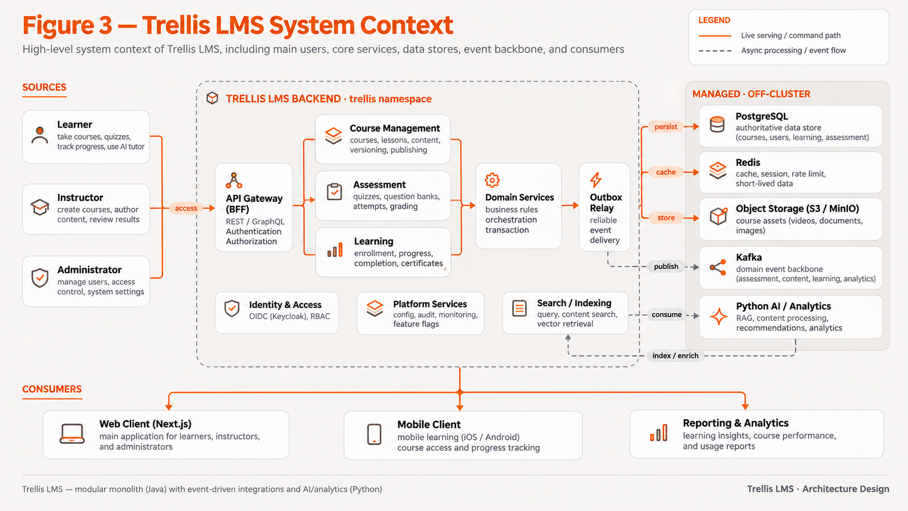

# Trellis Web

The Trellis frontend: a Next.js 15 App Router application in TypeScript, localised in Vietnamese,
English and Chinese, with its own design system on Tailwind tokens and Radix primitives.

It is also the BFF. The browser only ever calls `/api/*` on this server, which forwards to the
backend, so no backend origin and no API token ever reaches the browser.

Read [AGENTS.md](AGENTS.md) before changing anything: it is the canonical guide for this repo, for
humans and for agents alike.

## Architecture

The Web Client box is this repo: the Next.js application, which is also the BFF in front of the backend. The other boxes live in `trellis-backend` and `trellis-ai`.

### Figure 3: Trellis LMS system context

Who uses the system, the modular monolith in the middle, the stores it owns and the event backbone to the Python consumers.



## Sibling repos

Trellis is three repos (decision T21); this one holds only the frontend.

| Repo              | What                                                                                                                        |
| ----------------- | --------------------------------------------------------------------------------------------------------------------------- |
| `trellis-backend` | Java 21 / Spring Boot modular monolith. Owns the database, every business rule, and `contracts/`, `docker/`, `scripts/dev/` |
| `trellis-web`     | This repo                                                                                                                   |
| `trellis-ai`      | Python: RAG, Kafka workers, the backend SDK and the `trellis` CLI                                                           |

The API contract is not copied between repos. The backend's pipeline generates the OpenAPI client
and the GraphQL types and publishes them as the npm package `@trellis/contracts`, which this repo
installs at a pinned version (decision T22, see [AGENTS.md](AGENTS.md) "API contracts").

## Quick start

Requires Node 22 and pnpm (`mise install` reads [mise.toml](mise.toml); `.nvmrc` is there for nvm).

```bash
pnpm install
pnpm dev            # http://localhost:3000/vi — mock backend on, from .env.development
```

Routes are locale-prefixed: `/vi` (default), `/en`, `/zh`.

## Running against a backend

Two ways, and nothing else is needed locally — there is no infrastructure compose file here, because
Postgres, Kafka, Redis, MinIO and Keycloak belong to the backend's stack (decision T23).

**In-browser mocks, no backend at all.** The default for `pnpm dev`. Handlers live in `src/mocks/`
and answer with the backend's own contract; sample accounts are in `src/mocks/auth.seed.ts`.

```bash
NEXT_PUBLIC_MOCK_DOMAINS=true pnpm dev       # true | false | comma list, e.g. auth,notice
```

**A real backend.** Start it from the `trellis-backend` repo (`scripts/dev/trellis-dev.sh up` there
brings up the infrastructure and the app), then point this app at it and turn the mocks off:

```bash
cp .env.example .env.local
# .env.local:
#   TRELLIS_BACKEND_URL=http://localhost:8080
#   NEXT_PUBLIC_MOCK_DOMAINS=false
pnpm dev
```

`TRELLIS_BACKEND_URL` is read at runtime on the server only, never inlined into the bundle, so one
built image can serve every environment.

## Quality gate

Run this before pushing; CI ([.gitlab-ci.yml](.gitlab-ci.yml)) runs the same scripts.

```bash
pnpm contracts:check && pnpm typecheck && pnpm lint && pnpm format:check \
  && pnpm test && pnpm i18n:check && pnpm build && pnpm budget:check
```

| Command                | What                                                                       |
| ---------------------- | -------------------------------------------------------------------------- |
| `pnpm contracts:check` | This app and `@trellis/contracts` agree on a version                       |
| `pnpm test`            | Vitest; `test:coverage` adds Cobertura output for the MR widget            |
| `pnpm test:e2e`        | Playwright against `pnpm dev` on port 3100 (`--grep @p0` for the core set) |
| `pnpm i18n:check`      | Locale parity: same keys and `{placeholders}` in vi, en and zh             |
| `pnpm budget:check`    | First Load JS per route against `scripts/budget.json`, after a build       |

## Container

```bash
docker build -t trellis/web:local .
docker run --rm -p 3000:3000 -e TRELLIS_BACKEND_URL=http://host.docker.internal:8080 trellis/web:local
```

Next.js standalone output run by plain Node as an unprivileged user. `GET /api/health` is the
liveness probe: 200, no auth, no backend call.
